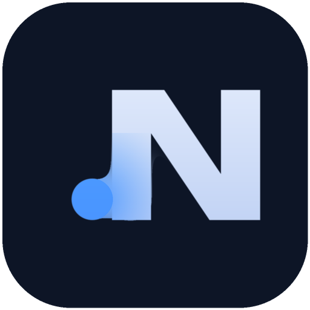
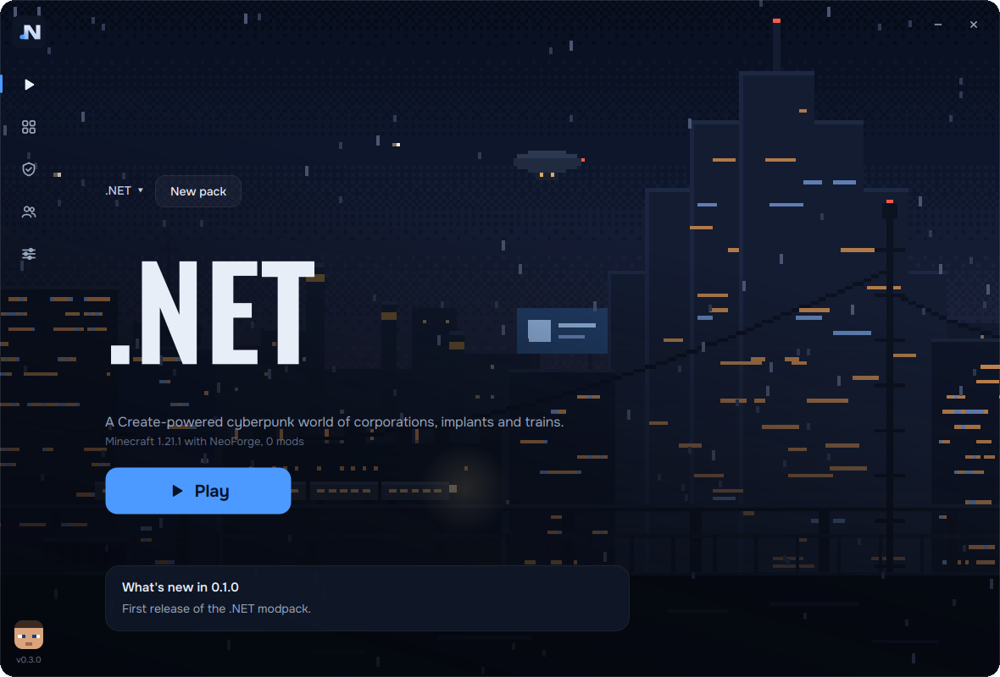
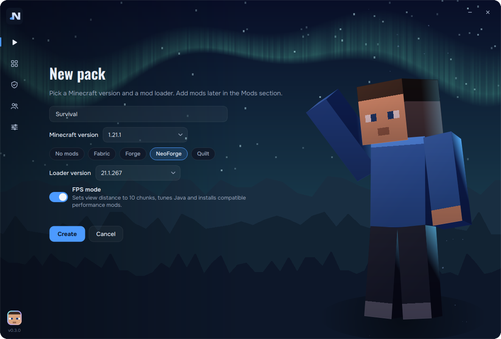
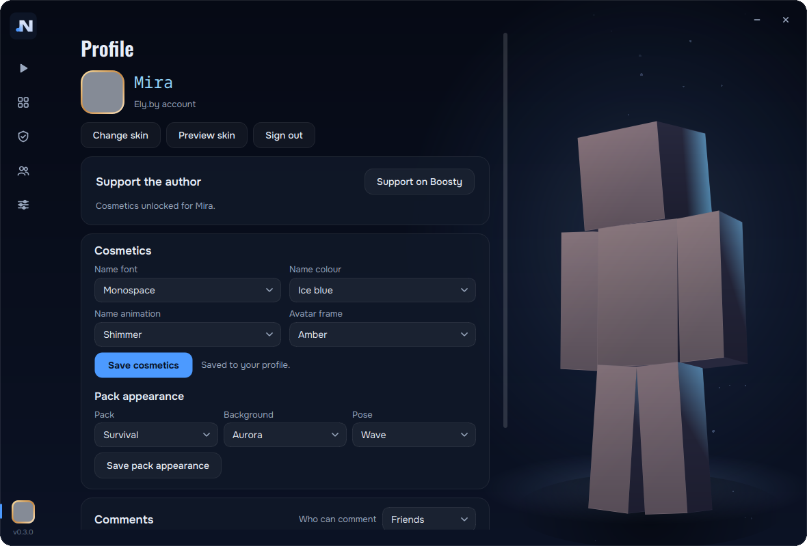

<p align="center"></p>

<h1 align="center">.NET Launcher</h1>
<p align="center">A Minecraft launcher for official modpacks and packs you build yourself.</p>
<p align="center">
  <a href="https://github.com/Sharkfj/net-launcher/releases"><strong>Download an installer</strong></a>
  &nbsp; · &nbsp;
  <a href="CHANGELOG.md">What's new</a>
</p>



## Play your first pack

1. On Windows, run **NET-Launcher-Setup.exe**. On x86_64 Linux, run `sh NET-Launcher-Linux-Setup.sh` to install for your user. The AppImage and archive are also available on the release page.
2. Choose English or Russian. Sign in with [Ely.by](https://account.ely.by/register) for your skin and multiplayer, or choose **Play without signing in** for single-player.
3. Open **Official**, select **.NET** and click **Install**. The launcher sets up Minecraft, Java and NeoForge. If a mod requires a manual download, follow the link and drop the file into the launcher.
4. Click **Play**. When an official pack update is available, the button changes to **Update**. The launcher backs up your worlds before applying it.

The official **.NET** pack runs on Minecraft 1.21.1 with NeoForge. Its cyberpunk world brings together Create machinery, trains, airships and Chromeware implants.

## Build a pack, make it yours

| Personal packs | Player profiles |
| :--- | :--- |
| [](docs/images/fps-en.png) | [](docs/images/profile-en.png) |
| Choose vanilla, Fabric, Forge, NeoForge or Quilt. **FPS mode** sets a 10-chunk render distance and installs compatible performance mods. | Click the head at the bottom of the sidebar to open your profile with a plain gray player model. A supporter key lets you choose a name font, colour and animation, plus an avatar frame. |

Open a pack to browse mods, resource packs and shaders. **Snapshots** lets you roll back a pack change. **Worlds** keeps up to five backups per world, and **Screenshots** opens the pictures you took in-game.

## Play with friends

- Add a friend by Ely.by nickname. Their profile shows the same plain gray player model. Profile owners choose who can post and can remove comments.
- Direct and group chats support screenshots and pack invitations. Online chat, comments, cosmetic sync and key redemption require a compatible [friends service](server/README.md).
- With the Discord desktop app running, **Discord activity** shows when you are in the launcher and which pack you are playing. You can turn it off in Settings.

<details>
<summary><strong>Watch the launcher start up</strong></summary>


</details>

## Microsoft sign-in configuration

1. In the [Microsoft Entra admin center](https://entra.microsoft.com/), open **App registrations → New registration**. Name the app **.NET Launcher** and select an account type that includes personal Microsoft accounts.
2. In the app's **Authentication** settings, turn **Allow public client flows** on. Copy the **Application (client) ID** from **Overview**. Device code sign-in uses this public ID and requires no client secret.
3. Request access to the [Minecraft Java Edition game service API](https://help.minecraft.net/hc/es-es/articles/16254801392141-New-Java-Edition-Game-Service-API-Review-or-Application-Process) for that app ID.
4. After approval, add the ID under **Settings → Secrets and variables → Actions → Variables** in the GitHub repository as `NET_MICROSOFT_CLIENT_ID`. Build the launcher again. For a run from source, set the environment variable of the same name before launching.

Microsoft accounts can launch Minecraft: Java Edition and load their skin. The launcher friends service uses Ely.by accounts.

## Run from source

From the repository root on Linux:

```bash
cd launcher
python3 -m venv .venv
.venv/bin/pip install -e . pytest
.venv/bin/python -m netlauncher
```

On Windows, use `.venv\Scripts\python.exe`. To run the Linux tests headlessly, use `QT_QPA_PLATFORM=offscreen .venv/bin/python -m pytest` from the launcher directory.

Developed by **@looper_fj**. Onest, Oswald and [Unbounded](launcher/tools/fonts) are distributed under the SIL Open Font License.

[All releases](https://github.com/Sharkfj/net-launcher/releases) · [Support the developer](https://boosty.to/shark_fj) · [Interface font licences](launcher/netlauncher/ui/assets/fonts)
